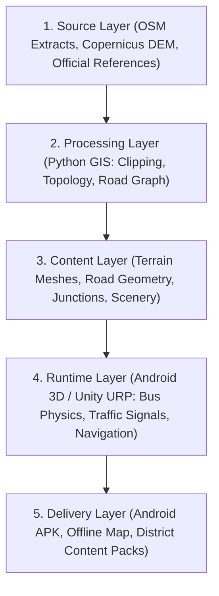

# System Architecture & Technical Guidelines

## 1. Architectural Layers

1. **Source Layer:** Raw geographic datasets (OSM XML/PBF, Copernicus DEM 30m). Sources, licenses (ODbL, CC-BY), retrieval dates, and attribution are strictly recorded in `docs/DATA_PROVENANCE.md`.
2. **Processing Layer (Offline Python):** Reprojection, road classification (NH, SH, MDR, ODR, Village), elevation interpolation, topology sanitization, and road graph generation (`nodes`, `edges`, `connectors`).
3. **Content Layer:** Procedural road ribbons, explicit junction meshes, terrain tiles, regional building/vegetation libraries, bus stops, railway hubs, and toll structures.
4. **Runtime Layer (Native Android 3D & Unity URP):** Tile manager, road graph pathfinding/navigation, bus vehicle physics, chase/cockpit/orbit cameras, safe-area mobile UI, audio, and real-time traffic signal simulation.
5. **Delivery Layer:** Standalone Android client (`com.bharatbussim.game`), offline-first map delivery, and modular district asset packs.

---

## 2. Geographic Foundation & Simulation Coordinates (Thrissur District)
* **Geographic CRS:** WGS84 (`EPSG:4326`)
* **Metric Projected CRS:** UTM Zone 43N (`EPSG:32643`)
* **District World Datum Anchor:** Thrissur Swaraj Round (Thekkinkadu Maidan Center)
  * **Coordinate:** `10.5244° N, 76.2144° E`
  * **UTM 43N:** `X = 632883.20 m, Y = 1163650.18 m, Elevation = 12.00 m`
* **Mini-Scale Factor (`CORRIDOR_SCALE = 0.20`):**
  * **Inter-town highway corridors:** 1:5 scale (20% distance compression) allowing 8–15 minute end-to-end district bus runs across Thrissur.
  * **Road cross-sections, vehicle physics, toll plazas, bridges, tunnels, and bus stands:** Strictly 1:1 metric scale (100% full real-world dimensions) to guarantee authentic steering, bus docking, overtaking, and bridge clearance.

---

## 3. Zone 1 Implementation: Thrissur Heart & City Transit Hubs
1. **Swaraj Round, Thekkinkadu Maidan & Vadakkumnathan Temple:**
   * **Roadway Ring:** 4 continuous lanes, strictly 1-way clockwise flow (`14.0 m` asphalt carriageway); `2.0 m` outer paved pedestrian sidewalk in grey and terracotta pavers with cast-iron ornamental bollards and chain link railings; `1.2 m` inner weathered laterite stone boundary wall (`Chuttumathil`, `#8B3A22`) with dressed laterite coping stones; alternating black and reflective highway yellow curb stones (`500 mm` pitch); 8 white thermoplastic pedestrian zebra crossings (`500 mm` wide bars, `500 mm` spacing, `3.0 m` length) at Manikandanal (South), Kuruppam Road, Bini Tourist Home, Round West (M.G. Road), Shoranur Road (North), Round North, Palace Road (East), and High Road.
   * **Thekkinkadu Maidan:** Rolling grassy mound elevating gently from `12.0 m` road level to `16.5 m` at the temple base (`#4F6239` to `#586E40`); ancient Banyan trees (`Aalmaram`, *Ficus benghalensis*) with hanging aerial roots and `1.0 m` dressed laterite circumambulation platforms (`Aalthara`); towering Teak and Mahogany trees; reddish laterite `Nadappatha` walkways; and Nehru Park on the south-eastern flank with swings, benches, and floral shrubs.
   * **Vadakkumnathan Temple:** 4 ceremonial Gopurams (North, South, East, West) with two-tier whitewashed granite/laterite stone plinths (`#F4EFE6`), multi-tiered sloped gabled terracotta roofs (`#B43E24`), carved teak rafters (`#4A2C18`), Kirtimukha/lotus pediments, and golden brass finials (`Stupika`); massive `18 m` diameter circular `Vatta Sreekovil` with conical gleaming copper roof (`#5C3A28`) and golden `Stupika` (`#FACC15`); rectangular `Koothambalam` with lattice woodwork walls and copper roof ridges; `21 m` golden `Kodimaram` flagstaff wrapped in brass rings; and `9 m` 7-tiered bronze `Deepastambham`.
2. **Sakthan Thampuran Bus Stand:**
   * `180 m × 120 m` heavy-duty concrete apron (`#2B3037`) with scored `6 m × 6 m` expansion joints, dark diesel oil drip stains, tire skid marks, and yellow thermoplastic trajectory lines; 3 parallel passenger boarding bays (`110 m` length) with `250 mm` raised tactile curbs, terracotta-red tubular steel columns (`#A83E28`), welded space trusses, deep royal blue corrugated steel roofs (`#1E3A8A`) with translucent polycarbonate skylights every `15 m`, and bilingual Malayalam/English white-on-blue enamel route signboards; `12 m` octagonal red-brick Clock Tower with cream plaster bands and 4 Roman-numeral analog dials at the northern exit gate; concrete time-keeper enquiry booth with roof PA horn speakers; `25 m` steel high-mast floodlight tower with 12 LED floodlights; and Player bus spawn in **Bay 1** facing straight north onto M.O. Road (`12.0 m` 4-lane 2-way).
3. **Thrissur Central Railway Station (`TCR`):**
   * Situated along Station Road / Kokkala parallel to the bus corridor; British-Cochin colonial cream-stucco facade (`#EAE4D7`) with exposed red-brick arcade arches, arched timber louvered windows, central porte-cochère, red-tile pitched roof with dormer vents, central station clock tower, and illuminated trilingual enamel sign (`തൃശ്ശൂർ / THRISSUR / त्रिशूर`); `UIC-60` broad-gauge rails on PSC sleepers in a `450 mm` basalt ballast bed; `25 kV AC` overhead catenary masts every `40 m`; Platform 1 & 2 blue corrugated sheds, `SOUTHERN RAILWAY` benches, yellow tactile strips, and blue-roofed steel Foot Over Bridge (`FOB`); and Southern Railway `WAP-7` electric locomotive (Royapuram/Erode cream & red livery) with raised pantograph coupled to blue ICF passenger coaches.
4. **City Traffic Signals & Street Culture:**
   * **Manikandanal Traffic Signal (Round South):** `6.5 m` cantilever galvanized steel mast arm over traffic lanes, 3-aspect `300 mm` LED signal heads (Red, Amber, Green) with black visors and `50 mm` yellow borders, pedestrian standing/walking man signal head, and live `Red (30s) -> Green (25s) -> Amber (4s)` cycle.
   * **Authentic Street Props:** Light-blue `milma` Milk Kiosk with outdoor ice cream freezer and blue/red milk crates; `Thattukada` (Tea Stall) with red-and-yellow tarpaulin, steaming brass samovar, glass snack case (Pazhampori, Parippuvada, Samosas), and hanging yellow Nendran bananas; and `AUTO STAND` with yellow-and-black curb markings and 3 parked Bajaj RE auto-rickshaws.

---

## 4. District Delivery Model & Quality Gates

Every district is developed, validated, and packaged through 7 standard gates:
* **G0 — Data Ready:** Source licenses verified, district boundary and OSM extract isolated.
* **G1 — Geography Validated:** Coordinate transformation passes, road tags mapped, topology clean.
* **G2 — Driveable Map:** Road and junction meshes generated with accurate collision and elevation alignment.
* **G3 — Visual Pass:** Kerala-specific vegetation, road signs, bridges, bus stops, and landmarks added.
* **G4 — Gameplay Pass:** Bus driving, route navigation, toll booths, and passenger pickup tested.
* **G5 — Android Pass:** 30+ FPS verified on physical Android target hardware, frame times and memory recorded.
* **G6 — District Accepted:** Boundary connectors verified for adjacent district linking, package versioned and frozen.

---

## 5. Performance Targets (Android Mobile)
* **Target Frame Rate:** Minimum stable 30 FPS on entry-tier devices, 60 FPS on mid-range devices.
* **Memory Budget:** Maximum 1.2 GB active RAM footprint in runtime.
* **Draw Calls (SetPass Calls):** Kept under 150 per frame via URP GPU Resident Drawer and SRP Batcher.
* **Rendering API:** Vulkan primary, OpenGL ES 3.2 fallback.
