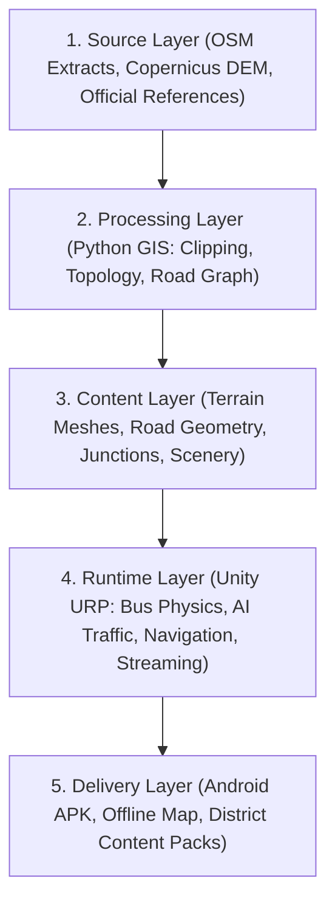

# System Architecture & Technical Guidelines

## 1. Architectural Layers

1. **Source Layer:** Raw geographic datasets (OSM XML/PBF, Copernicus DEM 30m). Sources, licenses (ODbL, CC-BY), retrieval dates, and attribution are strictly recorded in `docs/DATA_PROVENANCE.md`.
2. **Processing Layer (Offline Python):** Reprojection, road classification (NH, SH, MDR, ODR, Village), elevation interpolation, topology sanitization, and road graph generation (`nodes`, `edges`, `connectors`).
3. **Content Layer:** Procedural road ribbons, explicit junction meshes, terrain tiles, regional building/vegetation libraries, bus stops, and toll structures.
4. **Runtime Layer (Unity C# + URP):** Tile manager, road graph pathfinding/navigation, bus vehicle physics, chase camera, safe-area mobile UI, audio, and bounded traffic simulation.
5. **Delivery Layer:** Standalone Android client (`com.bharatbussim.game`), offline-first map delivery, and modular district asset packs.

---

## 2. Coordinate Transformation Policy
* **Source CRS:** WGS84 (`EPSG:4326`) for geographic latitude/longitude.
* **Metric Working CRS:** UTM Zone 43N (`EPSG:32643`) for Kerala and Western Tamil Nadu/Karnataka.
* **Unity Local CRS:**
  * Metric 1:1 scale (1 Unity unit = 1 real-world meter).
  * Origin point $(0, 0, 0)$ is fixed per district/regional anchor. For Thrissur, an approved central reference datum is established.
  * **Rule:** Never use raw latitude/longitude as Unity world coordinates. All coordinates must pass through the documented offset transformation:
    $$X_{unity} = X_{utm} - X_{origin}$$
    $$Z_{unity} = Y_{utm} - Y_{origin}$$
    $$Y_{unity} = Elevation_{dem} - Elevation_{origin}$$

---

## 3. District Delivery Model & Quality Gates

Every district is developed, validated, and packaged through 7 standard gates:
* **G0 — Data Ready:** Source licenses verified, district boundary and OSM extract isolated.
* **G1 — Geography Validated:** Coordinate transformation passes, road tags mapped, topology clean.
* **G2 — Driveable Map:** Road and junction meshes generated with accurate collision and elevation alignment.
* **G3 — Visual Pass:** Kerala-specific vegetation, road signs, bridges, bus stops, and landmarks added.
* **G4 — Gameplay Pass:** Bus driving, route navigation, toll booths, and passenger pickup tested.
* **G5 — Android Pass:** 30+ FPS verified on physical Android target hardware, frame times and memory recorded.
* **G6 — District Accepted:** Boundary connectors verified for adjacent district linking, package versioned and frozen.

---

## 4. Performance Targets (Android Mobile)
* **Target Frame Rate:** Minimum stable 30 FPS on entry-tier devices, 60 FPS on mid-range devices.
* **Memory Budget:** Maximum 1.2 GB active RAM footprint in runtime.
* **Draw Calls (SetPass Calls):** Kept under 150 per frame via URP GPU Resident Drawer and SRP Batcher.
* **Rendering API:** Vulkan primary, OpenGL ES 3.2 fallback.
